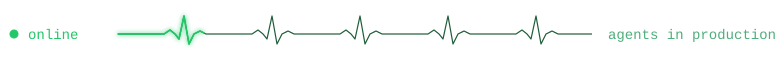

## Mostly agents, lately.

I build software that does real work on its own,  
and the quieter machinery that checks whether it actually did.

Right now I'm building an AI app builder at AllCognix AI: prompt in, full-stack app out.  
Before that, I was the sole engineer on Orkus, our agent orchestration platform.  
Final year of AI & Data Science, Pune.

---

> The model proposes. The harness decides.

---

### Things that work

**[Orkus](https://agents.allcognix.com)** · no-code agents, workflows and RAG. 130+ endpoints, one engineer.  
**[loom](https://github.com/KrishnaNaicker/loom)** · a coding harness where the model doesn't get to say "done".  
**Aceso** · self-healing web apps. Nothing ships past twelve checks and a human. Private.  
**Maya** · a kiosk you talk to. On-device Whisper, 9.6% WER, prices computed by code.

---

### Stack

Python · TypeScript · SQL  
FastAPI · Node · React · Postgres · MongoDB · Redis · Celery  
LangGraph · RAG · Pinecone · LLM APIs · Playwright · Docker · AWS

### Recently

Accepted into Anthropic's Claude for Startups with AllCognix AI.  
Odoo Hackathon 2026 finalist, 85th of 857. 3rd of 130+ at Pragyantra, as team lead.

---

[krishnanaicker.me](https://krishnanaicker.me) · [LinkedIn](https://www.linkedin.com/in/krishnanaicker29) · [X](https://x.com/NaickerKum48061) · [Email](mailto:krishnanaicker2005@gmail.com)

> README passed review. The harness was lenient.
